  <a href="https://jinpen-g.github.io/Zelo-website"><picture><source media="(prefers-color-scheme: dark)" srcset="./assets/hero-dark.svg" /><source media="(prefers-color-scheme: light)" srcset="./assets/hero-light.svg" /></picture></a>

  
  
  
  
  

---

### About / 关于我

> Full-stack architect and founder of **PenG-AI**, focused on modular multi-tenant SaaS infrastructure, pluggable business Cores, and governed AI Native / MCP systems.
>
> **PenG-AI** 发起人与全栈架构师，目前主力维护开源多租户 SaaS 底座 [**Zelo**](https://github.com/JinPen-G/Zelo)，专注「公共底座 × 独立业务 Core × 可控 AI Native / MCP」的工程化落地。

- **Building**: [Zelo](https://github.com/JinPen-G/Zelo) & [Zelo Rental Core](https://github.com/JinPen-G/Zelo-rental-core) — MIT-licensed multi-tenant SaaS base and industry Core ecosystem
- **Focus**: TypeScript · NestJS · React 19 · Next.js · Prisma · MySQL · AI Native Runtime · MCP
- **Collaborate / 交流与合作**: Open-source Core co-building, private deployment consulting, or architecture discussion — reach me via [**122083059@qq.com**](mailto:122083059@qq.com), [**X (@_JinPen)**](https://x.com/_JinPen), [**GitHub Discussions**](https://github.com/JinPen-G/Zelo/discussions), or [**GitHub Issues**](https://github.com/JinPen-G/Zelo/issues/new).

---

### Featured Projects / 核心项目

  <a href="https://github.com/JinPen-G/Zelo"><picture><source media="(prefers-color-scheme: dark)" srcset="./assets/card-zelo-dark.svg" /><source media="(prefers-color-scheme: light)" srcset="./assets/card-zelo-light.svg" /></picture></a>
  <a href="https://github.com/JinPen-G/Zelo-rental-core"><picture><source media="(prefers-color-scheme: dark)" srcset="./assets/card-rental-dark.svg" /><source media="(prefers-color-scheme: light)" srcset="./assets/card-rental-light.svg" /></picture></a>

  <a href="https://github.com/JinPen-G/Zelo-website"><picture><source media="(prefers-color-scheme: dark)" srcset="./assets/card-website-dark.svg" /><source media="(prefers-color-scheme: light)" srcset="./assets/card-website-light.svg" /></picture></a>
  <a href="https://github.com/JinPen-G/Zelo-pre"><picture><source media="(prefers-color-scheme: dark)" srcset="./assets/card-zelopre-dark.svg" /><source media="(prefers-color-scheme: light)" srcset="./assets/card-zelopre-light.svg" /></picture></a>

**More Open-Source & Engineering Tools / 更多开源工具**
- [`niuma-shed`](https://github.com/JinPen-G/niuma-shed) — 本地工作资料与项目进度综合管理记录平台
- [`magpie-agentrouter-responses-shim`](https://github.com/JinPen-G/magpie-agentrouter-responses-shim) & [`magpie-anyrouter-compat`](https://github.com/JinPen-G/magpie-anyrouter-compat) — OpenAI Responses API 网关兼容与路由中间件插件

---

### Tech Stack / 技术栈

  <picture>
    <source media="(prefers-color-scheme: dark)" srcset="https://skillicons.dev/icons?i=ts%2Cjs%2Cnodejs%2Cnestjs%2Creact%2Cnextjs%2Cvite%2Ctailwind%2Cprisma%2Cmysql%2Credis%2Cdocker%2Cgit%2Cgithub%2Clinux&perline=15&theme=dark" />
    <source media="(prefers-color-scheme: light)" srcset="https://skillicons.dev/icons?i=ts%2Cjs%2Cnodejs%2Cnestjs%2Creact%2Cnextjs%2Cvite%2Ctailwind%2Cprisma%2Cmysql%2Credis%2Cdocker%2Cgit%2Cgithub%2Clinux&perline=15&theme=light" />
    
  </picture>

---

### Contribution Activity / 提交轨迹

  <picture>
    <source media="(prefers-color-scheme: dark)" srcset="https://raw.githubusercontent.com/JinPen-G/JinPen-G/output/github-contribution-grid-snake-dark.svg" />
    <source media="(prefers-color-scheme: light)" srcset="https://raw.githubusercontent.com/JinPen-G/JinPen-G/output/github-contribution-grid-snake.svg" />
    
  </picture>

  <picture>
    <source media="(prefers-color-scheme: dark)" srcset="./assets/footer-dark.svg" />
    <source media="(prefers-color-scheme: light)" srcset="./assets/footer-light.svg" />
    
  </picture>

